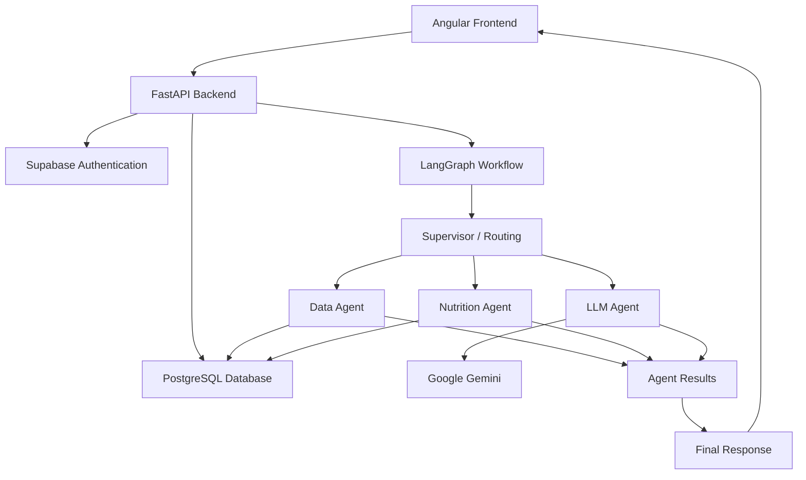

# HealthGPT — AI-Powered Health & Nutrition Assistant

HealthGPT is an AI-powered health and nutrition assistant designed to help users track meals, understand their nutritional intake, monitor health goals, and receive personalized insights through conversational AI.

The project combines a **FastAPI backend, Angular frontend, Supabase, and LangGraph-based agentic workflows** to connect structured health data with AI-powered reasoning.

> **Project status:** Active development. Features and integrations are evolving. This project is intended for educational and portfolio demonstration purposes, not as a substitute for professional medical advice.

## Key Features

- **User Authentication:** Supabase Auth with JWT-based backend authentication.
- **Health Profiles:** Store and manage user health information and goals.
- **Meal Tracking:** Record meals and retrieve meal history.
- **Nutrition Insights:** Analyze nutritional intake using structured backend data.
- **Budget Tracking:** Retrieve and analyze food-budget summaries.
- **AI Health Assistant:** Interact with a conversational AI assistant.
- **Multi-Agent Architecture:** Use LangGraph to coordinate specialized agents for nutrition analysis, data retrieval, and response generation.
- **Persistent Conversations:** Maintain chat threads and message history.
- **Context-Aware Responses:** Combine user profile information, meal history, and structured health data to provide relevant responses.

## Architecture



### Technology Stack

| Layer | Technologies |
|---|---|
| Frontend | Angular, TypeScript, HTML, CSS |
| Backend | Python, FastAPI |
| AI / Orchestration | LangGraph, Google Gemini |
| Database | Supabase PostgreSQL |
| Authentication | Supabase Auth, JWT |
| ORM | SQLAlchemy |
| Testing | Pytest |

## Agentic Workflow

HealthGPT uses a LangGraph-based architecture to coordinate specialized components.

- **Supervisor / Routing:** Determines the appropriate workflow based on the user's request.
- **Data Agent:** Retrieves structured information such as meal history and budget summaries.
- **Nutrition Agent:** Handles nutrition-related analysis using structured data.
- **LLM Agent:** Handles conversational reasoning and requests that require language-model capabilities.
- **Response Generation:** Combines the available results into a user-facing response.

The architecture is designed to prioritize structured backend data for deterministic queries and use the LLM for reasoning where appropriate.

## Project Structure

```text
healthgpt/
├── app/
│   ├── ai/
│   │   ├── agents/
│   │   ├── graph/
│   │   └── chat_workflow.py
│   ├── api/
│   ├── services/
│   ├── auth.py
│   ├── db.py
│   ├── main.py
│   ├── models.py
│   └── schemas.py
├── frontend/
│   ├── src/
│   │   └── app/
│   ├── package.json
│   └── angular.json
├── tests/
├── .env.example
├── .gitignore
├── requirements.txt
└── test_nutrition_validator.py
```

## Getting Started

### Prerequisites

- Python 3.12+
- Node.js and npm
- A Supabase project
- A Google Gemini API key

### 1. Clone the Repository

```bash
git clone https://github.com/VINAMRA-123/HealthGPT.git
cd HealthGPT
```

### 2. Backend Setup

Create and activate a virtual environment:

```bash
python -m venv .venv
```

Windows Git Bash:

```bash
source .venv/Scripts/activate
```

Install dependencies:

```bash
pip install -r requirements.txt
```

Create your local environment file:

```bash
cp .env.example .env
```

Configure the required environment variables in `.env`:

```dotenv
SUPABASE_URL=your_supabase_url
DATABASE_URL=your_postgresql_connection_string
GEMINI_API_KEY=your_gemini_api_key
GEMINI_MODEL=your_configured_gemini_model
GEMINI_FALLBACK_MODELS=your_fallback_models
```

Start the backend:

```bash
uvicorn app.main:app --reload
```

The FastAPI server should be available at:

`http://127.0.0.1:8000`

API documentation:

`http://127.0.0.1:8000/docs`

### 3. Frontend Setup

Open another terminal:

```bash
cd frontend
npm install
```

Configure the Supabase URL and publishable key in the Angular environment configuration.

Start Angular:

```bash
npm start
```

Open the local frontend URL displayed by Angular CLI, typically:

`http://localhost:4200`

## Running Tests

From the project root:

```bash
python -m pytest -v
```

## Security Notes

- Keep `.env` out of version control.
- Never expose Supabase service-role keys or database credentials in frontend code.
- Use Supabase Row Level Security (RLS) policies to protect user data.
- Configure authentication and authorization before exposing the application publicly.
- Do not use this project for medical diagnosis or treatment decisions.

## Current Development Status

The repository includes the Angular frontend, FastAPI backend, Supabase integration, conversational workflows, and LangGraph agent components.

The backend API tests currently pass. Deployment, broader end-to-end testing, and additional documentation are planned as the project evolves.

## Future Improvements

- Deploy the frontend and backend.
- Add a demonstration video and application screenshots.
- Expand automated unit and integration tests.
- Improve agent evaluation and response reliability.
- Enhance personalization and nutrition insights.
- Add observability and tracing for agent workflows.

## Author

**Vinamra Gupta**

- GitHub: [VINAMRA-123](https://github.com/VINAMRA-123)
- LinkedIn: [Vinamra Gupta](https://www.linkedin.com/in/vinamra-gupta-vg14052002)
