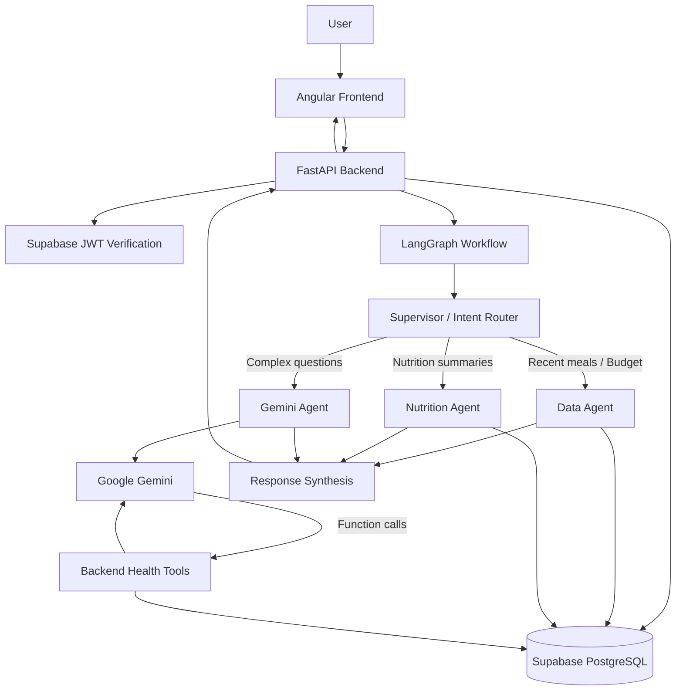

# HealthGPT — Agentic AI Health & Nutrition Assistant

**HealthGPT** is an AI-powered personal health and nutrition assistant that combines structured health data, database-backed analytics, and conversational AI to help users understand their nutrition, track meals, monitor goals, and make informed food choices.

The project explores a practical approach to building agentic AI applications: **use deterministic backend logic for questions that require reliable personal data, and use an LLM with tools for questions that require contextual reasoning.**

### Project at a Glance

| Area                | Implementation                  |
| ------------------- | ------------------------------- |
| Frontend            | Angular 21, TypeScript          |
| Backend             | Python, FastAPI                 |
| Agent orchestration | LangGraph                       |
| LLM                 | Google Gemini                   |
| Database            | Supabase PostgreSQL             |
| Authentication      | Supabase Auth, JWT verification |
| ORM                 | SQLAlchemy                      |
| Observability       | LangSmith (traces, latency, token usage) |
| Evaluation          | Offline eval suite (routing + data validation), LangSmith experiments |
| Testing             | Pytest (backend), Vitest (frontend) |
| CI                  | GitHub Actions                  |
| Deployment          | Vercel (frontend), Render (API), Supabase (database) |

> **Status:** Active development. The application is deployed (Vercel + Render + Supabase), has automated backend and frontend tests running in CI, LangSmith tracing, and an offline evaluation suite. Broader end-to-end validation is ongoing. HealthGPT is a portfolio project, not a medical diagnosis or treatment system.

---

## 1. Problem Statement

Health and nutrition information is often fragmented across meal logs, personal goals, nutritional targets, and spending records.

A conventional chatbot may generate plausible advice but cannot reliably answer questions about a user's actual logged data without retrieving it.

HealthGPT addresses this by combining:

- Structured storage of user profiles and meal records.
- Database-backed nutrition and budget calculations.
- Agent-based request routing.
- LLM-powered conversational reasoning with backend tools.
- Persistent conversations and user-specific context.

The objective is to build an assistant that can reason over available user data without treating generated responses as a substitute for verified records.

## 2. Core Features

### User and Health Profile

- Supabase-based user authentication.
- User-specific health profiles.
- Dietary preferences and health goals.
- Configurable daily calorie and macro targets, and a daily food budget.
- Dashboard with a calorie ring, macro progress, budget usage and a tabbed 7-day trend chart.

### Meal Tracking

- Record meals and nutritional information.
- Track calories, protein, carbohydrates, fats, and meal costs.
- Retrieve recent meal history.
- Validate recorded nutrition values and flag suspicious or incomplete data.
- Search foods from a built-in Indian-food catalogue and Open Food Facts, with server-side pagination, infinite scroll and result caching.
- Edit and delete meals with instant list and totals updates.

### Nutrition Analytics

- Daily nutrition summaries.
- Weekly protein summaries.
- Historical nutrition queries.
- Comparisons and analysis of logged meals.
- Budget and spending summaries.

### Conversational AI

- Context-aware health and nutrition conversations.
- Gemini function calling for backend data retrieval.
- Persistent chat threads and message history.
- Configurable primary and fallback Gemini models.
- Streaming LLM response generation.

## 3. System Architecture

HealthGPT uses a layered architecture with a LangGraph orchestration workflow.



### Request Lifecycle

1. The user sends a message through the Angular chat interface.
2. FastAPI authenticates the request and obtains the user identity.
3. Relevant profile information, recent meal context, and conversation history are prepared.
4. The LangGraph supervisor classifies the request.
5. A conditional edge selects the appropriate execution path.
6. The selected agent retrieves structured information or invokes the Gemini workflow.
7. The synthesis node validates the agent result and prepares the final response.
8. The response and conversation messages are persisted and returned to the frontend.

## 4. Agentic Workflow — LangGraph

The application uses a supervisor-based graph to route requests to specialized execution paths.

### Supervisor

The supervisor classifies incoming requests and selects the appropriate agent.

Current routing includes:

| User intent                     | Selected agent  | Execution                      |
| ------------------------------- | --------------- | ------------------------------ |
| Recent meals                    | Data Agent      | Database retrieval             |
| Weekly budget                   | Data Agent      | Database calculations          |
| Daily nutrition                 | Nutrition Agent | Database-backed summary        |
| Weekly protein                  | Nutrition Agent | Database-backed summary        |
| Period nutrition                | Nutrition Agent | Period-based nutrition summary |
| Complex or analytical questions | Gemini Agent    | LLM reasoning and tool calling |

The current graph selects **one specialist agent per request**. It is not a parallel multi-agent debate architecture.

### Data Agent

Responsible for structured meal and budget retrieval.

Responsibilities:

- Retrieve recent meal records.
- Retrieve weekly budget information.
- Validate returned meal records.
- Attach data-quality information.
- Return structured results to the graph.

### Nutrition Agent

Responsible for nutrition-specific database queries.

Responsibilities:

- Retrieve daily nutrition summaries.
- Calculate weekly protein totals.
- Handle supported period-based nutrition queries.
- Return structured nutrition results.

### Gemini Agent

Handles requests requiring conversational reasoning and tool usage.

The existing Gemini workflow is reused inside the larger LangGraph workflow rather than duplicating the LLM client and tool definitions.

The Gemini workflow supports:

- Function calling.
- Backend tool execution.
- Repeated LLM and tool interactions.
- Configurable primary and fallback models.
- Streaming text output.
- A maximum of five tool-execution rounds per request.

### Response Synthesis

The synthesis node:

- Collects the selected agent's result.
- Handles missing or invalid responses.
- Returns a consistent response structure.
- Preserves metadata such as the selected model and number of meals considered.

## 5. Engineering Decisions

### 5.1 SQL-first for predictable questions

A question such as "How much protein have I consumed today?" should be answered from recorded meal data, not from the LLM's training knowledge.

HealthGPT routes supported predictable queries to deterministic database operations.

**Why this matters:**

- Avoids unnecessary LLM calls.
- Reduces inference cost and latency.
- Makes personal-data calculations reproducible.
- Keeps generated answers grounded in stored records.

The LLM is used when the question requires interpretation, comparison, or contextual reasoning.

### 5.2 Reusing the existing Gemini workflow

Instead of duplicating Gemini configuration, tool declarations, and execution logic, the LangGraph integration invokes the existing Gemini workflow.

This separates:

- High-level request orchestration.
- LLM interaction and tool-calling loop.
- Backend data-access operations.

It also makes the components easier to maintain independently.

### 5.3 Tool-based access to personal data

The Gemini workflow has access to backend tools for retrieving:

- Nutrition summaries.
- Recent meals.
- Budget summaries.
- Health profile information.

The LLM requests information through function calls; the backend executes the operations and returns their results.

### 5.4 Persistent conversation history

Chat threads and messages are stored in PostgreSQL.

The implementation:

- Associates messages with a conversation thread and user.
- Retrieves recent conversation history.
- Reuses that history when constructing the Gemini conversation.
- Stores assistant responses and model metadata.

This provides continuity across chat requests rather than relying only on in-memory conversation state.

### 5.5 User authentication

The backend verifies Supabase access tokens using the Supabase JSON Web Key Set (JWKS).

JWT verification includes:

- Signature verification.
- Expected issuer.
- Authenticated audience.
- Token expiration and required claims.
- Authenticated role validation.

The authenticated user identity is used by protected backend operations to scope access to personal records.

### 5.6 Observability with LangSmith

Every chat request is traced in [LangSmith](https://smith.langchain.com) so agent behaviour can be inspected instead of guessed at.

What a trace contains:

- One `healthgpt_chat` run per message, with a child run for each LangGraph node (supervisor, data agent, nutrition agent, Gemini agent, synthesis).
- Every Gemini call as its own LLM run with the model name, latency, streamed output and **token counts**.
- Failed calls to the primary model appear as errored runs followed by the fallback model's run, so **model fallbacks are visible**.
- Every backend tool call (`health_tool`) with its arguments and the *shape* of its result.
- Tags `intent:<name>` and `path:sql` / `path:llm`, so SQL-answered and LLM-answered questions can be filtered and compared.
- A `thread_id` so the messages of one conversation are grouped together.

Tracing is **off by default**. To enable it, add to `.env` (or the Render environment):

```dotenv
LANGSMITH_TRACING=true
LANGSMITH_API_KEY=your_langsmith_api_key
LANGSMITH_PROJECT=healthgpt
APP_ENV=production        # lets you filter production vs local traces
```

**Privacy:** traces can contain chat messages and meal data. User ids are never sent raw (a short one-way hash is used). For real users set `LANGSMITH_HIDE_INPUTS=true` and `LANGSMITH_HIDE_OUTPUTS=true` so only structure, timing, token counts and errors are uploaded. Tests never upload traces.

### 5.7 Evaluation-driven development

Routing decides whether a question is answered from the user's own data (SQL) or by the LLM, so a wrong route gives a wrong kind of answer. The routing and validation logic is therefore measured, not assumed.

```bash
python -m evals.run_evals               # print results
python -m evals.run_evals --json out.json
python -m evals.run_evals --langsmith   # upload dataset + experiments to LangSmith
```

The suite scores:

- **Intent routing** on a labelled question set, reporting accuracy, per-intent precision/recall, and two error types separately: general questions wrongly answered from SQL, and data questions wrongly sent to the LLM.
- **Nutrition validation** on labelled meal records, reporting precision and recall of the "flagged" decision.

The first evaluation found a real bug: the original router matched keywords as substrings, so `"ate"` matched inside *latest* and *update*, and `"past"` matched inside *pasta*. "How many calories are in pasta?" was treated as a query over the user's logged meals. The router (`app/ai/intent.py`) now matches whole words, and the old implementation is kept in `chat.py` as `classify_intent_legacy` so the improvement stays reproducible.

> The evaluation set is small and hand-written by the author, so treat the percentages as a regression guard and a comparison between two routers, not as a measure of real-world accuracy. Extend `evals/datasets.py` with real user questions to strengthen it.

<!-- Paste your own results here after running `python -m evals.run_evals`. -->

### 5.8 Reliability and abuse protection

- **Rate limiting:** chat is limited per user and food search per IP, returning HTTP 429 with a `Retry-After` header. Chat is the endpoint that costs money (Gemini).
- **Fast, resilient food search:** the two Open Food Facts queries run in parallel with short timeouts, results are cached, and when the external service is slow the UI says so instead of showing an empty list.
- **Gemini fallbacks:** if the primary model fails before any text was streamed, the next configured model is tried; after partial output the request fails rather than restarting mid-answer.
- **Backend performance:** gzip responses, a one-hour Supabase key cache for JWT verification, and a composite database index on `meal_logs (user_id, consumed_at)`.
- **Frontend:** lazy-loaded routes, auth route guards, stale-while-revalidate dashboard data, and a start-up ping that wakes the free-tier API.
- **CI:** GitHub Actions runs the backend tests, frontend unit tests and a production build on every push and pull request.

## 6. Nutrition Data Quality and Safety

Nutrition data can be incomplete or internally inconsistent. HealthGPT includes a validation layer to identify potential data-quality problems.

### Nutrition Validation

The validator checks:

- Calories.
- Protein.
- Carbohydrates.
- Fat.
- Missing values.
- Negative or non-finite numerical values.
- Significant differences between recorded calories and macronutrient-derived estimates.

The calorie cross-check uses:

```text
Estimated calories = 4 × P + 4 × C + 9 × F
```

Where:

- `P` = protein in grams.
- `C` = carbohydrates in grams.
- `F` = fat in grams.

A record that fails the available checks is flagged with warnings. The validator preserves the original recorded values instead of silently modifying them.

**Important:** Passing these checks indicates that a record passed the implemented validation rules. It does not prove that the nutrition information is factually accurate.

### LLM Response Safeguards

The assistant is instructed to:

- Distinguish logged meals from actual total consumption.
- Avoid treating historical meals as today's intake.
- Avoid inventing missing nutrition targets.
- Explain limitations when records are incomplete or flagged.
- Avoid drawing conclusions about an entire diet from a small sample of meals.
- Present estimates as estimates rather than verified facts.

HealthGPT does not provide medical diagnosis or replace professional healthcare advice.

## 7. Example Use Cases

The following are representative workflows the application is designed to support.

### Use Case 1 — Daily Nutrition

**User:** How much protein have I consumed today?

**Execution:**

1. Recognize a supported daily nutrition query.
2. Retrieve today's nutrition data from PostgreSQL.
3. Calculate totals from recorded meals.
4. Return the result with the configured target, if available.

### Use Case 2 — Recent Meal Analysis

**User:** Which of my recent meals had the most protein?

**Execution:**

1. Route the analytical request to Gemini.
2. Invoke the recent-meals backend tool.
3. Inspect available meal records and their data-quality flags.
4. Compare reliable recorded values.
5. Explain the result and any limitations.

### Use Case 3 — Weekly Food Budget

**User:** How much of my weekly food budget have I spent?

**Execution:**

1. Route the request to the Data Agent.
2. Retrieve the user's configured budget.
3. Aggregate recorded meal costs for the current week.
4. Return recorded spending and estimated remaining budget.

These examples describe the intended workflows; actual results depend on the user's stored records and configured profile.

## 8. Project Structure

```text
HealthGPT/
│
├── app/
│   ├── ai/
│   │   ├── agents/
│   │   │   ├── builder.py
│   │   │   ├── data_agent.py
│   │   │   ├── nutrition_agent.py
│   │   │   ├── nutrition_validator.py
│   │   │   └── supervisor.py
│   │   ├── graph/
│   │   │   ├── routing.py
│   │   │   └── state.py
│   │   ├── chat_workflow.py
│   │   ├── intent.py          # word-boundary intent router
│   │   └── tracing.py         # LangSmith helpers
│   │
│   ├── api/
│   │   ├── chat.py
│   │   ├── food_search.py
│   │   ├── meals.py
│   │   └── profiles.py
│   │
│   ├── services/
│   │   └── nutrition_service.py
│   │
│   ├── auth.py
│   ├── db.py
│   ├── main.py
│   ├── models.py
│   ├── rate_limit.py
│   └── schemas.py
│
├── frontend/
│   └── src/
│       └── app/
│           ├── core/services/
│           └── features/
│               ├── auth/
│               ├── dashboard/
│               ├── health-chat/
│               ├── health-profile/
│               └── meal-tracking/
│
├── evals/                     # routing + validator evaluation suite
├── tests/
├── .github/workflows/ci.yml
├── conftest.py
├── test_nutrition_validator.py
├── requirements.txt
├── .env.example
└── .gitignore
```

## 9. Technology Stack

| Technology          | Role                                          |
| ------------------- | --------------------------------------------- |
| Angular 21          | Interactive frontend                          |
| TypeScript          | Frontend application logic                    |
| FastAPI             | Backend REST APIs                             |
| Python              | Backend and AI orchestration                  |
| LangGraph           | Stateful agent workflow orchestration         |
| LangSmith           | Tracing, latency/token monitoring, evaluation experiments |
| Google Gemini       | Conversational reasoning and function calling |
| Supabase PostgreSQL | Persistent application data                   |
| Supabase Auth       | User authentication                           |
| PyJWT               | JWT verification                              |
| SQLAlchemy          | Database access and ORM                       |
| Pytest              | Backend testing                               |

## 10. Local Setup

### Prerequisites

- Python 3.12+
- Node.js and npm
- Supabase project with PostgreSQL configured
- Google Gemini API key

### Clone the repository

```bash
git clone https://github.com/VINAMRA-123/HealthGPT.git
cd HealthGPT
```

### Backend

Create and activate a virtual environment:

```bash
python -m venv .venv
```

Windows Git Bash:

```bash
source .venv/Scripts/activate
```

Install dependencies:

```bash
pip install -r requirements.txt
```

Create the environment file:

```bash
cp .env.example .env
```

Configure the required values in `.env`:

```dotenv
SUPABASE_URL=https://your-project-ref.supabase.co
DATABASE_URL=your_postgresql_connection_string

GEMINI_API_KEY=your_gemini_api_key
GEMINI_MODEL=your_configured_gemini_model
GEMINI_FALLBACK_MODELS=your_fallback_models

# Optional: LangSmith tracing (off unless LANGSMITH_TRACING=true)
LANGSMITH_TRACING=true
LANGSMITH_API_KEY=your_langsmith_api_key
LANGSMITH_PROJECT=healthgpt
APP_ENV=development
```

Ensure the PostgreSQL database has the required application schema before starting the backend.

Start FastAPI:

```bash
uvicorn app.main:app --reload
```

Backend:

`http://127.0.0.1:8000`

Interactive API documentation:

`http://127.0.0.1:8000/docs`

Health endpoint:

`http://127.0.0.1:8000/health`

### Frontend

Open a second terminal:

```bash
cd frontend
npm install
```

Configure the Supabase URL and publishable key in:

`frontend/src/environments/environments.ts`

Start Angular:

```bash
npm start
```

The frontend is available at:

`http://localhost:4200`

### Deployment

| Part     | Platform | Notes |
| -------- | -------- | ----- |
| Frontend | Vercel   | Root directory `frontend`. `vercel.json` rewrites all paths to `index.html` so refreshing `/dashboard` works. |
| API      | Render   | Start command `uvicorn app.main:app --host 0.0.0.0 --port $PORT`. Health check path `/health`. |
| Database | Supabase | Run the schema and the index below once. |

Render environment variables: `SUPABASE_URL`, `DATABASE_URL`, `GEMINI_API_KEY`, `GEMINI_MODEL`, `GEMINI_FALLBACK_MODELS`, `FRONTEND_URL` (your Vercel URL, for CORS), `APP_ENV=production`, and optionally the `LANGSMITH_*` variables.

Production index (the dashboard and chat filter meals by user and date):

```sql
CREATE INDEX IF NOT EXISTS idx_meal_logs_user_consumed
  ON meal_logs (user_id, consumed_at);
```

The free Render tier sleeps when idle. The frontend pings `/health` on start-up to wake it, and an uptime monitor hitting `/health` every 10 minutes keeps it awake.

## 11. Testing

Run the backend test suite from the project root:

```bash
python -m pytest -v
```

Backend tests run offline: no database, Gemini key or network is needed (`conftest.py` supplies dummy settings). They cover:

- API routes: health endpoint and profile route registration.
- Food search: matching, Open Food Facts normalisation, pagination fields, degraded-service handling.
- Rate limiting: sliding window, per-key budgets, HTTP 429 with `Retry-After`.
- Intent routing: word-boundary matching and regression cases for the old substring bugs.
- Gemini workflow: model fallback, no model switch after partial output, tool-call loop, tool failures, token-usage conversion (using a fake Gemini client).
- LangSmith helpers: opt-in behaviour, anonymised ids, run tags.

Frontend tests and the production build:

```bash
cd frontend
npm test -- --watch=false
npm run build
```

Run the evaluation suite separately (see section 5.7):

```bash
python -m evals.run_evals
```

GitHub Actions (`.github/workflows/ci.yml`) runs the backend tests, frontend tests and production build on every push to `main` and on pull requests.

## 12. Future Enhancements & Roadmap

HealthGPT is continuously evolving, with a focus on making its agentic architecture more intelligent, reliable, and scalable.

Planned enhancements include:

- **Advanced Multi-Agent Collaboration:** Extend the supervisor architecture to support coordinated execution of multiple specialized agents for complex health and nutrition queries.
- **Broader Agent Evaluation:** Extend the routing evaluation to end-to-end answer quality (LLM-as-judge experiments in LangSmith), tool-selection accuracy, and a larger set of real user questions.
- **Enhanced Nutrition Intelligence:** Improve nutritional data verification, consistency checks, and personalized nutrition insights.
- **Resilient LLM Integration:** Strengthen Gemini integration with fallback strategies, error handling, and optimized API usage.
- **Production Monitoring:** LangSmith dashboards and alerts for latency, error rate and token cost, plus collection of user feedback on answers.
- **Expanded Testing:** Add integration tests against a test database and browser-based end-to-end tests for the main user flows.

## 13. Author

**Vinamra Gupta**

- GitHub: [VINAMRA-123](https://github.com/VINAMRA-123)
- LinkedIn: [Vinamra Gupta](https://www.linkedin.com/in/vinamra-gupta-vg14052002)

---

*Built as an applied AI engineering project exploring agentic workflows, structured data retrieval, LLM tool calling, and reliable conversational applications.*
